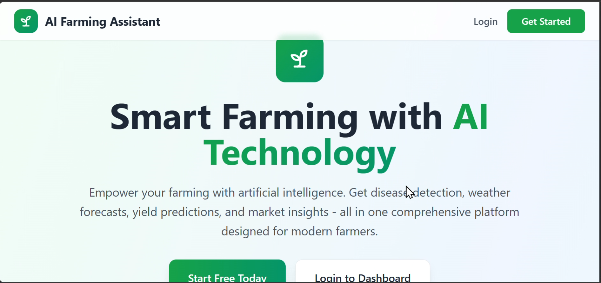

<div align="center">

# 🌱 AI Farming Assistant

### Smart Farming Platform Powered by Artificial Intelligence

Helping farmers make better decisions using AI, weather insights, crop analysis, and market intelligence.


---

🚀 **Live Demo:** *(Coming Soon)*

📹 **Project Demo:** *(Coming Soon)*

</div>

---

# 📖 Overview

AI Farming Assistant is an intelligent agriculture platform that empowers farmers with AI-driven recommendations and real-time information.

The application combines modern web technologies with Artificial Intelligence to improve farming productivity, reduce crop losses, and support data-driven agricultural decisions.

---

# ✨ Features

✅ Crop Disease Detection

✅ Weather Forecasting

✅ Smart Irrigation Advice

✅ Crop Yield Prediction

✅ Market Price Analysis

✅ Clean & Responsive UI

---

# 📸 Project Screenshots

## 🏠 Home Page



---

## 🌦 Weather Forecast


---

## 🌿 Disease Detection


---

## 🌾 Yield Prediction


---

## 💰 Market Prices


---

# 🏗 Project Architecture

```
             User
               │
               ▼
      React + TypeScript
               │
               ▼
      Application Logic
               │
      ┌────────┼────────┐
      │        │        │
      ▼        ▼        ▼
 Weather  Disease  Prediction
  Module    Module    Module
      │        │        │
      └────────┼────────┘
               │
               ▼
          Result Display
```

---

# 🛠 Tech Stack

## Frontend

- React
- TypeScript
- Vite
- Tailwind CSS

## AI Modules

- Machine Learning Concepts
- Prediction Models

## Tools

- VS Code
- Git
- GitHub
- npm

---

# 📂 Folder Structure

```
src/
│
├── components/
├── widgets/
├── services/
├── contexts/
├── types/
│
├── App.tsx
├── main.tsx
└── index.css
```

---

# ⚙ Installation

Clone the repository

```bash
git clone https://github.com/sakshirakate11/AI-Farming-Assistant.git
```

Go to project

```bash
cd AI-Farming-Assistant
```

Install dependencies

```bash
npm install
```

Run the application

```bash
npm run dev
```

Build Project

```bash
npm run build
```

---

# 🚀 Future Improvements

- AI Chatbot for Farmers
- Voice Assistant
- Soil Analysis
- Multilingual Support
- Live Weather API
- Satellite Monitoring
- IoT Sensor Integration
- Mobile Application

---

# 🤝 Contributing

Contributions are welcome.

Fork the repository.

Create a feature branch.

Commit your changes.

Create a Pull Request.

---

# 📄 License

This project is licensed under the MIT License.

---

# 👩‍💻 Author

**Sakshi Balasaheb Rakate**

B.Tech Artificial Intelligence & Machine Learning

GitHub:
https://github.com/sakshirakate11

---

<div align="center">

⭐ If you like this project, don't forget to Star the repository.

Made with ❤️ using React & AI

</div>
